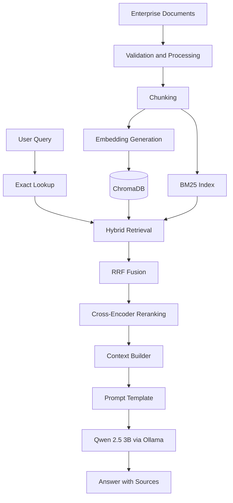

# Enterprise-Hybrid-RAG-Assistant

### Hybrid Retrieval-Augmented Generation (RAG) System

A local enterprise knowledge assistant built using **Hybrid Search, Reciprocal Rank Fusion, Cross-Encoder Reranking, and a locally hosted LLM**.

The system retrieves relevant information from an enterprise knowledge base and generates context-grounded answers using Qwen 2.5 3B through Ollama.

---

## 1. Project Overview

Enterprise organizations maintain large volumes of information about employees, departments, projects, expenses, vendors, policies, and IT tickets.

Searching through these records manually is time-consuming. General-purpose LLMs may also produce unsupported answers when they lack access to enterprise-specific information.

This project addresses these challenges by implementing an end-to-end RAG pipeline that:

- Retrieves relevant information using vector and keyword search.
- Combines retrieval results using Reciprocal Rank Fusion (RRF).
- Improves ranking using a Cross-Encoder.
- Builds relevant context for the LLM.
- Generates answers using a locally hosted model.
- Abstains when sufficient supporting information is unavailable.

**Objective:** Build a local-first enterprise RAG system that provides relevant and context-grounded answers without paid LLM APIs or cloud-based vector databases.

## 2. Technology Stack

| Component | Technology |
|---|---|
| Language | Python |
| LLM | Qwen 2.5 3B |
| LLM Runtime | Ollama |
| Embedding Model | all-MiniLM-L6-v2 |
| Vector Database | ChromaDB |
| Keyword Search | BM25 |
| Hybrid Ranking | Reciprocal Rank Fusion |
| Reranker | Cross-Encoder MiniLM |
| Evaluation | RAGAS |
| Evaluation Embeddings | all-MiniLM-L6-v2 |

All model inference and evaluation are configured for local execution.

## 3. Dataset

The project uses a synthetic enterprise knowledge base representing TechNova Solutions.

| Document Category | Records |
|---|---:|
| Departments | 10 |
| Employees | 1,000 |
| Projects | 300 |
| Vendors | 300 |
| Expenses | 3,000 |
| IT Tickets | 1,500 |
| HR Policies | 10 |
| Project Updates | 5,000 |
| **Total** | **11,110** |

The documents are stored in JSONL format and processed into 11,110 chunks.

### Evaluation Dataset

A balanced sample of 85 questions was used for RAGAS evaluation:

- 60 factual questions
- 10 policy questions
- 5 paraphrased questions
- 10 unanswerable questions

The sample contains 75 answerable and 10 unanswerable questions.

## 4. System Architecture



### Retrieval and Generation Workflow

1. **Ingestion:** Load and validate enterprise documents.
2. **Chunking:** Prepare documents for embedding and retrieval.
3. **Embedding:** Convert document content into 384-dimensional vectors.
4. **Storage:** Store vectors and metadata in ChromaDB.
5. **Exact Lookup:** Handle supported exact employee-name, identifier, and project-title queries.
6. **Hybrid Retrieval:** Retrieve candidates through vector search and BM25.
7. **RRF Fusion:** Combine both ranked result lists.
8. **Reranking:** Score query-document pairs using a Cross-Encoder.
9. **Context Building:** Select the most relevant documents.
10. **Generation:** Use Qwen to generate an answer from the prepared context.

## 5. Retrieval Implementation

### Hybrid Search

The system combines two retrieval methods:

**Vector Search**
- Finds semantically similar documents.
- Handles questions with different wording but similar meaning.

**BM25 Keyword Search**
- Finds documents using keyword matching.
- Helps with names, identifiers, policy terms, and specific keywords.

The project retrieves the top 20 candidates from each retrieval method and combines their rankings using RRF.

### Reciprocal Rank Fusion (RRF)

RRF combines ranked lists using rank positions rather than comparing raw retrieval scores.

\[
RRF(d)=\sum_{r\in R}\frac{1}{k+rank_r(d)}
\]

Where:

- \(d\): Document
- \(R\): Retrieval result lists
- \(k\): RRF constant (60)
- \(rank_r(d)\): Document rank in a result list

### Cross-Encoder Reranking

The fused candidates are reranked using:

`cross-encoder/ms-marco-MiniLM-L-6-v2`

The Cross-Encoder evaluates the query and each candidate document together, producing a relevance score. The highest-ranked results are passed to the context builder.

### Context Building

The context builder selects the strongest retrieved documents and prepares the final context for the LLM.

Current configuration:

| Parameter | Value |
|---|---:|
| Maximum documents | 3 |
| Maximum context characters | 12,000 |
| Score margin | 3.0 |

## 6. Answer Generation

The system uses **Qwen 2.5 3B through Ollama**.

The prompt instructs the model to:

- Answer using the retrieved context.
- Avoid unsupported information.
- Include supporting source IDs where applicable.
- Abstain when sufficient evidence is unavailable.

This helps reduce unsupported answers and keeps responses grounded in the enterprise knowledge base.

## 7. Evaluation

Evaluation was performed at two levels:

1. Retrieval evaluation using custom metrics.
2. Generation and context-quality evaluation using RAGAS.

### 7.1 Retrieval Evaluation

The retrieval pipeline was evaluated using Recall@5, Precision@5, and MRR@20.

**Recall@5**

Measures how many relevant documents were retrieved within the top five results.

\[
Recall@5 =
\frac{\text{Relevant documents retrieved in top 5}}
{\text{Total relevant documents}}
\]

**Precision@5**

Measures the proportion of the top five retrieved documents that are relevant.

\[
Precision@5 =
\frac{\text{Relevant documents in top 5}}{5}
\]

**Mean Reciprocal Rank (MRR@20)**

Measures the ranking position of the first relevant document.

\[
MRR@20 =
\frac{1}{N}\sum_{i=1}^{N}\frac{1}{rank_i}
\]

A higher MRR indicates that relevant documents tend to appear closer to the top.

### Retrieval Results

| Retrieval Method | Recall@5 | Precision@5 | MRR@20 |
|---|---:|---:|---:|
| Vector Search | 47.85% | 9.57% | 0.4434 |
| BM25 | 84.49% | 16.90% | 0.8245 |
| Hybrid Search (RRF) | 94.59% | 18.92% | 0.7423 |
| Hybrid + Cross-Encoder | **97.62%** | **19.52%** | **0.9459** |

**Observation:** Hybrid retrieval improved Recall@5 compared with vector search alone. Adding Cross-Encoder reranking further improved Recall@5 and MRR@20 on the evaluated dataset.

### 7.2 RAGAS Evaluation

Initially, custom Python scripts were used for generation and faithfulness evaluation. Later, RAGAS was introduced to provide a standardized evaluation approach.

The final evaluation uses four RAGAS metrics:

| Metric | What It Measures |
|---|---|
| Faithfulness | Whether generated claims are supported by retrieved context |
| Answer Relevancy | Whether the answer addresses the user's question |
| Context Precision | Whether relevant contexts are ranked above irrelevant contexts |
| Context Recall | Whether retrieved context contains the information needed to answer the question |

#### RAGAS Score Interpretation

All four metrics generally range from **0 to 1**, with higher scores indicating better performance.

The following are practical interpretation guidelines, not official RAGAS thresholds.

| Score | Interpretation |
|---|---|
| 0.00–0.39 | Low |
| 0.40–0.69 | Moderate |
| 0.70–0.89 | Good |
| 0.90–1.00 | Excellent |

**How to interpret low scores:**

- Low Faithfulness: Investigate unsupported claims, retrieved context, and prompt instructions.
- Low Answer Relevancy: Investigate question understanding and answer generation.
- Low Context Precision: Investigate hybrid retrieval and reranking.
- Low Context Recall: Investigate ingestion, chunking, and retrieval coverage.

RAGAS scores are automated evaluator estimates, not guarantees of correctness. Individual low-scoring examples should be manually inspected.

#### Evaluation Configuration

- Evaluator LLM: Qwen 2.5 3B through local Ollama.
- Evaluation embeddings: all-MiniLM-L6-v2.
- Evaluation sample: 85 questions.
- Answerable questions: 75.
- Unanswerable questions: 10.

The evaluation results are stored in:

`evaluation/results/ragas_evaluation_results.json`

RAGAS evaluates generation and context quality; it does not replace the custom Recall@5, Precision@5, and MRR@20 retrieval calculations.

## 8. Project Structure

```text
RAG Project/
│
├── employee-handbook-rag/
│   ├── data/
│   │   ├── documents/
│   │   └── evaluation/
│   ├── generation/
│   │   ├── answer_generator.py
│   │   ├── context_builder.py
│   │   ├── prompt_template.py
│   │   └── rag_pipeline.py
│   ├── requirements.txt
│   └── validate_dataset.py
│
├── ingestion/
│   └── ingest.py
│
├── retrieval/
│   ├── hybrid_search.py
│   └── reranker.py
│
├── evaluation/
│   ├── balanced_evaluation_sample.jsonl
│   ├── create_evaluation_sample.py
│   ├── evaluate_retrieval_with_reranker.py
│   ├── evaluate_with_ragas.py
│   ├── ragas_config.py
│   └── results/
│
├── tests/
├── vector_db/
├── architecture.mmd
└── README.md
```

## 9. Running the Project

### Prerequisites

- Python
- Ollama
- Git

### Clone the repository

```bash
git clone <YOUR_GITHUB_REPOSITORY_URL>
cd <YOUR_REPOSITORY_FOLDER>
```

### Create and activate a virtual environment

```bash
python -m venv .venv
```

Windows PowerShell:

```powershell
.venv\Scripts\Activate.ps1
```

### Install dependencies

```bash
pip install -r employee-handbook-rag/requirements.txt
```

### Download the local LLM

```bash
ollama pull qwen2.5:3b
```

Ensure Ollama is running before executing the application.

### Validate the dataset

```bash
python employee-handbook-rag/validate_dataset.py
```

### Build the vector database

```bash
python ingestion/ingest.py
```

### Run the RAG pipeline

The main pipeline is implemented in:

`employee-handbook-rag/generation/rag_pipeline.py`

It exposes the `ask_question()` function to process a user query and return the generated answer, retrieved contexts, sources, and status.

### Run retrieval evaluation

```bash
python evaluation/evaluate_retrieval_with_reranker.py
```

### Run RAGAS evaluation

```bash
python evaluation/evaluate_with_ragas.py --limit 2
```

For the complete 85-question evaluation:

```bash
python evaluation/evaluate_with_ragas.py
```

Evaluation dependencies and the local evaluation model configuration must be available in the active environment.

## 10. Limitations

- The knowledge base is synthetic and primarily consists of structured, relatively short records.
- Evaluation was performed on a limited balanced sample of 85 questions for generation quality.
- RAGAS evaluation depends on an automated LLM evaluator and can produce imperfect judgments.
- Performance may differ on real-world enterprise documents, particularly long documents and complex multi-document questions.
- The current results should not be interpreted as production-level performance guarantees.

## 11. Key Takeaways

This project demonstrates practical implementation of:

- End-to-end RAG architecture.
- Document ingestion and embedding generation.
- Vector search and BM25 keyword retrieval.
- Hybrid retrieval using RRF.
- Cross-Encoder reranking.
- Context selection and prompt engineering.
- Local LLM inference using Ollama.
- Grounded answer generation and abstention.
- Retrieval evaluation using Recall@K, Precision@K, and MRR.
- RAGAS evaluation using Faithfulness, Answer Relevancy, Context Precision, and Context Recall.

---

**Built as a hands-on project to understand and implement the complete Retrieval-Augmented Generation workflow using local and open-source technologies.**
